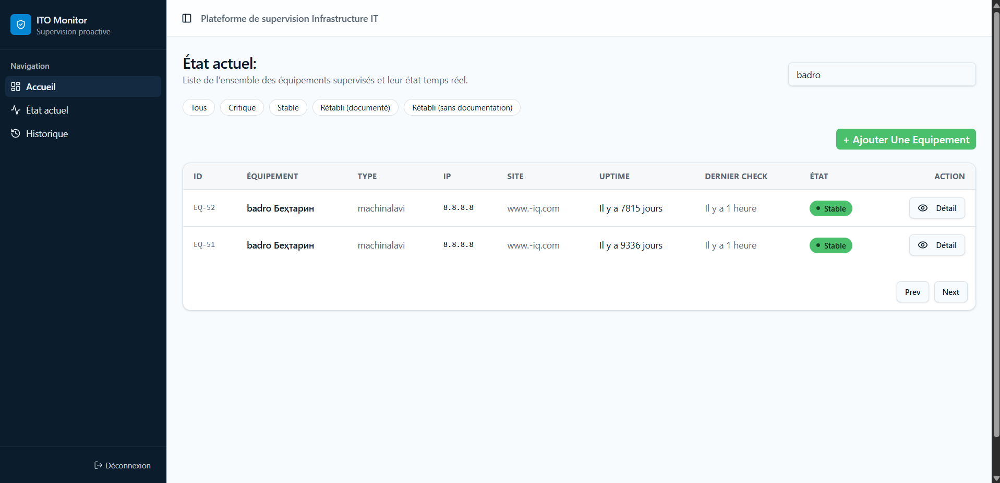

#ITOMonitor

**A lightweight, self-hosted infrastructure monitoring platform built with ASP.NET Core 10.**

An alternative to traditional monitoring solutions like Nagios, ItoMonitor provides continuous availability monitoring, centralized service management, and automated email notifications.

## 🚀 Features

- **24/7 Availability Monitoring** — Continuously monitor your infrastructure and services.
- **Multi-Service Monitoring** — Monitor various services and protocols, including:
  - Microsoft SQL Server (MSSQL)
  - HTTP / HTTPS endpoints
  - And more.
- **Email Alerts** — Automatically receive email notifications when a monitored service becomes unavailable.
- **Centralized Management** — Manage multiple services from a single web interface.
- **Service Health Tracking** — Keep track of service availability and identify failures.

## 🛠️ Built With

- **ASP.NET Core 10**
- **C#**
- **Microsoft SQL Server**
- **SMTP** for email notifications

## 📸 Screenshots





## ⚙️ Getting Started
## ⚙️ Getting Started
## ⚙️ Getting Started

### Prerequisites

- .NET 10 SDK
- Microsoft SQL Server
- SMTP server (for email notifications)

### Installation

1. Clone the repository:

   ```bash
   git clone https://github.com/publicStaticVoidSassi/ItoMonitor.git
   cd ItoMonitor
   ```

2. Configure your application settings.

3. Apply database migrations:

   ```bash
   dotnet ef database update
   ```

4. Restore dependencies and run:

   ```bash
   dotnet restore
   dotnet build
   dotnet run
   ```

## 📧 Email Notifications

ItoMonitor supports automated email notifications to keep administrators informed whenever a monitored service experiences an outage.

Configure your SMTP settings to enable notifications.

