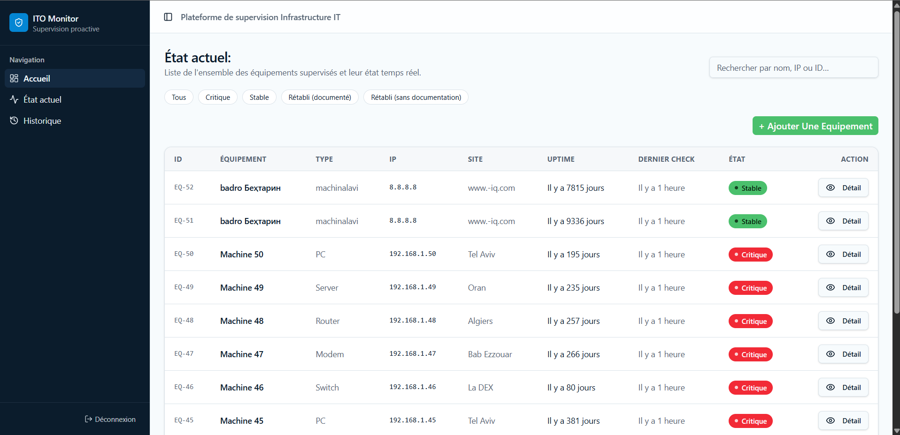
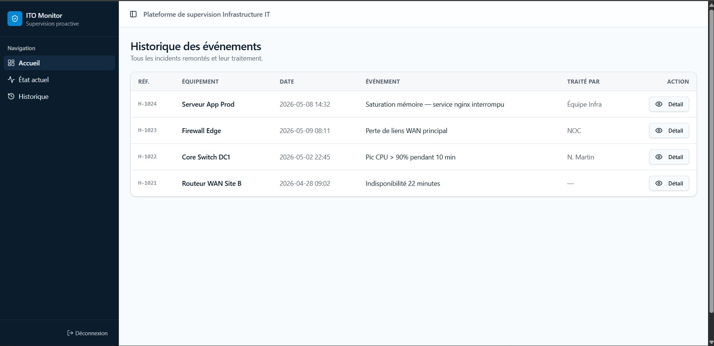

#ITOMonitor

**A lightweight, self-hosted infrastructure monitoring platform built with ASP.NET Core 10.**

An alternative to traditional monitoring solutions like Nagios, ItoMonitor provides continuous availability monitoring, centralized service management, and automated email notifications.

## 🚀 Features

- **24/7 Availability Monitoring** — Continuously monitor your infrastructure and services.
- **Multi-Service Monitoring** — Monitor various services and protocols, including:
  - Microsoft SQL Server (MSSQL)
  - HTTP / HTTPS endpoints
  - And more.
- **Email Alerts** — Automatically receive email notifications when a monitored service becomes unavailable.
- **Centralized Management** — Manage multiple services from a single web interface.
- **Service Health Tracking** — Keep track of service availability and identify failures.

## 🛠️ Built With

- **ASP.NET Core 10**
- **C#**
- **Microsoft SQL Server**
- **SMTP** for email notifications

## 📸 Screenshots

